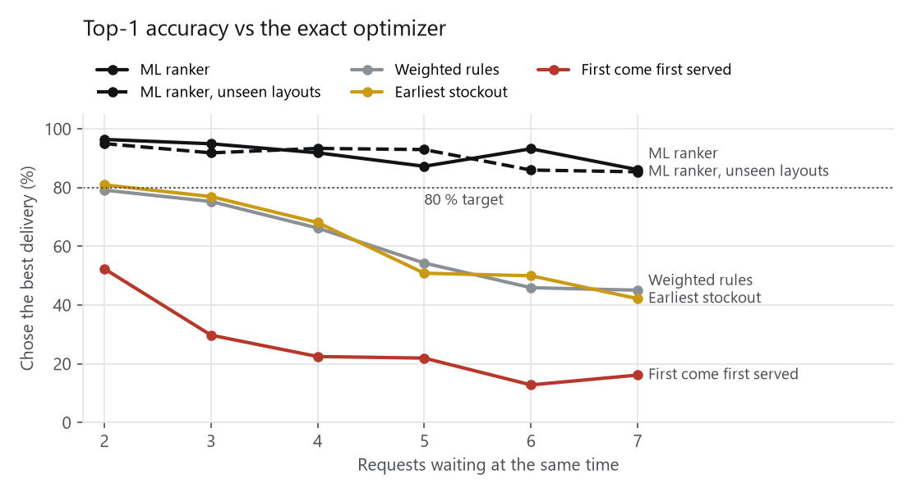

# Carkaroo: AI dispatcher for a factory line-follower car

**Carkaroo** = car + kangaroo: like a kangaroo with its pouch, our car **Roo** carries boxes to the stations before they run out.

A small automated guided vehicle (AGV) carries material boxes around a factory floor. Every station weighs its own bins, so the system always knows how much stock is left. When stations need material, an **AI running on the laptop** decides **which delivery goes first** and sends the car a route it can follow, junction by junction.

> Grade 12 Capstone 2026/2027, *Information Technology and Artificial Intelligence Applications*, industrial pathway (fully automated production lines).

## How it works

1. **Sensing:** load cells under each station's bins report the stock. The car has IR line sensors, an ultrasonic obstacle sensor and a servo fork.
2. **Forecasting:** the AI learns each station's usage rate from the readings.
3. **Automatic requests:** when a station will reach its safety stock before a delivery could arrive (plus a look-ahead), the AI creates the request itself. No operator is needed.
4. **Deciding what goes first:** a machine-learning ranker looks at:
   - time until each station runs out;
   - trip time to the rack and the station;
   - station criticality;
   - waiting time;
   - what would happen to the *other* requests.

   It picks the delivery that keeps production running. Hard safety rules come first: warehouse stock, room for a box, battery, and blocked lines.
5. **Routing:** the path planner turns the route into one command per junction (`STRAIGHT`, `LEFT`, `RIGHT`, `UTURN`, `STOP`), followed by `LIFT` or `LOWER` for the fork.
6. **Explaining:** every decision comes with reasons and a "what if the other one went first" comparison.
7. **Live dashboard:** a web page on the laptop shows the AI's choice, why, the queue, the car on the factory map, and the station stock, live ([docs/dashboard.md](docs/dashboard.md)).

See [docs/architecture.md](docs/architecture.md) for the diagrams.

## Results (simulation, situations the model never saw)

| | ML ranker | Weighted rules (hand-made) | First come, first served | Exact optimizer |
|---|---|---|---|---|
| Picks the best delivery: our track (1000 situations) | **91.6 %** | 61.3 % | 26.2 % | 100 % |
| Picks the best delivery: 200 new factory layouts | **91.1 %** | 57.7 % | 27.3 % | 100 % |
| Picks the best delivery: live operation (40 one-hour runs) | **83.8 %** | 46.8 % | 37.7 % | 100 % |
| Picks the best delivery: 14 **real** factories (KIT data set) | **85.6 %** | 41.7 % | 26.6 % | 100 % |
| Extra cost vs the optimal plan (live operation) | **0.8 %** | 10.3 % | 22.9 % | 0 % |
| Decision time | ~10–20 ms | < 0.1 ms | < 0.1 ms | grows with n! |

The ML ranker cuts production stop time by **42 %** compared with first come, first served. Its accuracy clears the capstone's **80 %** target in all four tests: our track, factories it has never seen, live operation (where it runs the factory itself), and 14 real factories from German industry. It was trained on our track, 400 random factory layouts, 300 large random factories at real-factory scale, and 18,000 situations from live operation (DAgger), so a new or changed track needs no retraining. The real factories are never used for training. Full reports: [reports/evaluation.md](reports/evaluation.md) and [reports/real_layouts.md](reports/real_layouts.md).



**Second model: shortage risk.** For each station, the probability that it runs out before a box sent now could arrive, while demand changes with shifts, production orders, surges and downtime (simulated). On test timelines it never saw it is right **97.8 %** of the time (factories never seen: 97.7 %), against 96.9 % for a formula using the production plan and 92.4 % for "stock ÷ rate < arrival time". It gives calibrated probabilities (Brier 0.017). The ranker still decides; the risk explains the urgency. Report: [reports/risk_model.md](reports/risk_model.md). Both models can be trained step by step in Google Colab, with nothing to install on a PC: [open the notebook in Colab](https://colab.research.google.com/github/noureldinGM/Capstone-AVG/blob/main/notebooks/carkaroo_ai_colab.ipynb) ([notebooks/carkaroo_ai_colab.ipynb](notebooks/carkaroo_ai_colab.ipynb); setup steps at its top).

## Quick start (Windows)

```bash
python -m venv .venv
```
```bash
.venv\Scripts\python -m pip install -r requirements.txt
```
Start the Carkaroo website (MQTT broker with device keys, the AI, the website at http://localhost:8050). Log in with the factory's name, build it on the **Setup** page (stations, track, device keys) and press Start:
```bash
.venv\Scripts\python scripts\run_app.py
```
No car or stations yet? The **Carkaroo Simulator** (http://localhost:8060) is a separate website that pretends to be them and logs in with the same keys ([how](docs/dashboard.md#practise-with-the-simulator)):
```bash
.venv\Scripts\python scripts\run_simulator.py
```
For developers, a quick simulated factory without a broker or the website:
```bash
.venv\Scripts\python scripts\run_factory_sim.py
```

Or one decision in the terminal:
```bash
.venv\Scripts\python scripts\demo.py
```

The trained model is in `models/ranker.joblib`, so both work right away. To rebuild everything from scratch (about 15 minutes):

```bash
.venv\Scripts\python scripts\generate_dataset.py
```
```bash
.venv\Scripts\python scripts\train_ranker.py
```
```bash
.venv\Scripts\python scripts\train_live.py
```
```bash
.venv\Scripts\python scripts\evaluate.py
```
```bash
.venv\Scripts\python scripts\evaluate_real_layouts.py
```
```bash
.venv\Scripts\python -m pytest
```

## Demo

`python scripts/demo.py` reads the (simulated) station sensors and decides by itself:

```
=== Needs detected automatically ===
- A -> S1: S1 (Assembly line 1) has 10 A left, uses 3.0/min: safety level in 80 s, empty in 3.3 min; a delivery takes ~51 s.
- B -> S3: S3 (Packaging) has 2 B left, uses 2.0/min: safety level in 0 s, empty in 60 s; a delivery takes ~39 s.

=== AI decision (policy: ml) ===
1. B -> S3 (Packaging)   done in 39 s   score 1.00
2. A -> S1 (Assembly line 1)   done in 1.8 min   score 0.00

Why:
 * Go first: B -> S3 (Packaging). It has 2 units left and runs out in 60 s; the trip takes 39 s (criticality 2).
 * If A -> S1 (Assembly line 1) went first instead: S3 would stop 42 s longer (cost +92).
 * The exact optimizer agrees with this choice.

=== Commands sent to the car for task 1 (one per junction) ===
to rack W-B    path HOME > J1 > J2 > W-B
            commands STRAIGHT, RIGHT, LEFT, STOP, then LIFT (servo fork up)
to S3         path W-B > J2 > J5 > S3
            commands UTURN, STRAIGHT, STRAIGHT, STOP, then LOWER (servo fork down)
```

Other things to try:
- `--request A:S1 --request B:S3`: manual requests, "bring A and B at the same time"
- `--stock S3:B=8`: change a sensor reading and watch the decision change
- `--block J2-J5`: an obstacle blocks a line, so the car re-routes
- `--battery 15`: the car charges first
- `--policy fifo`: compare with a simple rule
- `python scripts/sensitivity.py` sweeps a stock level and shows where the decision flips (`reports/sensitivity.png`)

## Project layout

New to the project? Start with [CONTRIBUTING.md](CONTRIBUTING.md): where everything is and how to work on it.

```
agv_brain/            the AI: map, forecaster, need detector, safety, simulator,
                      random and real layouts, optimizer, features, ML ranker, explainer,
                      dispatcher, controller, message bus, broker, simulated car and stations
agv_brain/dashboard/  the website (server.py + static/ pages, served by the AI)
config/               factory track, materials/stations/car settings, MQTT settings
                      (*.local.yaml = device keys and saved mode: secret, never in git)
scripts/              run_app (everything), demo, dataset, training, evaluation, broker tools
models/               trained ranker
data/sample/          sample of the training dataset (the full one is regenerated)
data/external/        the 30 real KIT factory layouts (CC BY 4.0, see its README)
design/               Carkaroo design system: tokens, logos, Roo, style guide;
                      design/print/ = poster and portfolio drafts (kept by the team)
reports/              evaluation reports and charts
docs/                 architecture, plan, protocol, requirements, dataset, ML rubric,
                      calibration, dashboard, security
firmware/             car firmware notes (BW20-12F-Kit), to be written in Phase 3
tests/                pytest suite (MQTT tests skip when no broker is running)
```

## Hardware

| Part | Role |
|---|---|
| Ai-Thinker BW20-12F-Kit (dual-band Wi-Fi + BLE 5.0) | car controller |
| IR sensor array | line following and junction detection |
| HC-SR04 ultrasonic | obstacle detection |
| Servo | fork lift |
| Load cell + HX711 per bin, on Ai-Thinker boards | station stock sensing |
| Laptop | edge computer: MQTT broker + AI |
| HiveMQ Cloud (planned) | cloud data and dashboard |

## Real car and cloud

The AI and the website only talk MQTT ([docs/protocol.md](docs/protocol.md)), so the real car and stations plug in without changes. Run `scripts/run_app.py`, choose **Real car** on the Setup page, and put the car's key (Setup → Devices → Connect) in its firmware. Every device has its own key, and the broker refuses anyone else. Draw your real track in the Setup page's editor; no retraining is needed.

This needs Mosquitto (`winget install --id EclipseFoundation.Mosquitto -e`). Its Windows service only listens on the laptop, so stop it once as administrator (`Stop-Service mosquitto`, `Set-Service mosquitto -StartupType Manual`); see [docs/dashboard.md](docs/dashboard.md). For the cloud bridge, see [docs/project-plan.md](docs/project-plan.md), Phase 2.

## Documents
- [Project plan and roadmap](docs/project-plan.md)
- [Live dashboard](docs/dashboard.md)
- [Carkaroo design system](design/README.md): colors, logo, type, 3D and slide rules (live style guide at http://localhost:8050/design/)
- [Architecture](docs/architecture.md)
- [Communication protocol (MQTT)](docs/protocol.md)
- [Measurable design requirements](docs/design-requirements.md)
- [Dataset](docs/dataset.md) and [ML rubric](docs/ml-rubric.md)
- [Sensor calibration](docs/calibration.md)
- [Security](docs/security.md): how the website and the broker are protected
- [Working on the project](CONTRIBUTING.md): where things are, branches, tests
- [Firmware notes](firmware/README.md)
