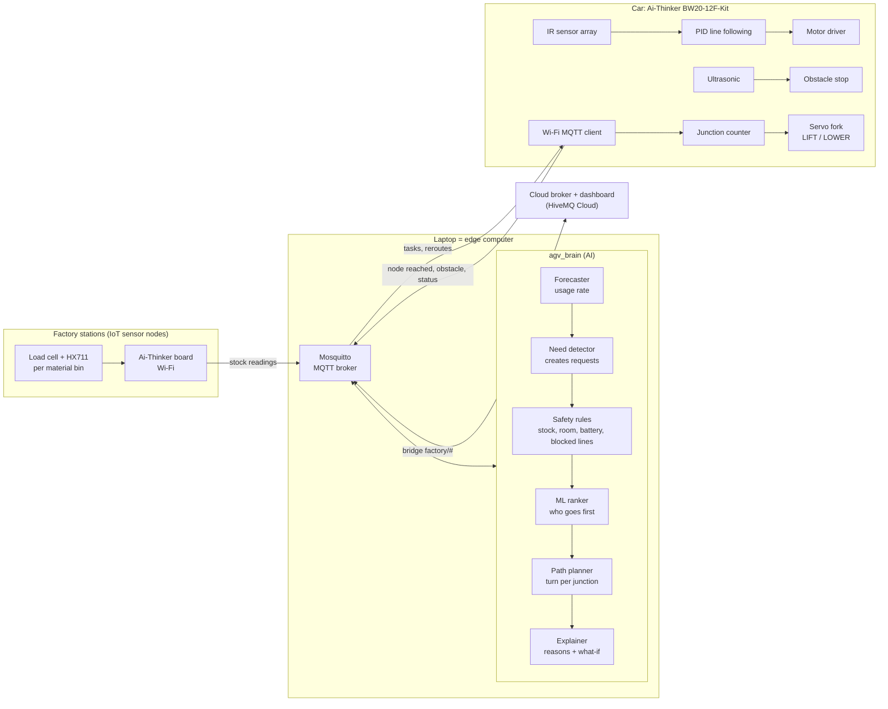
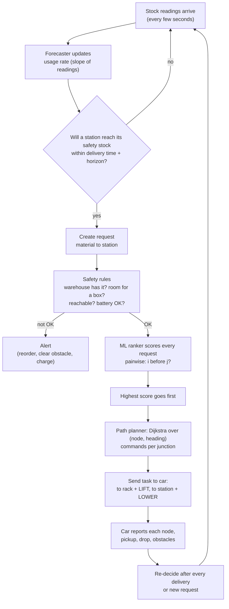
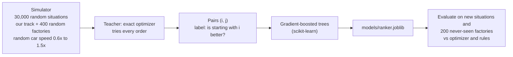
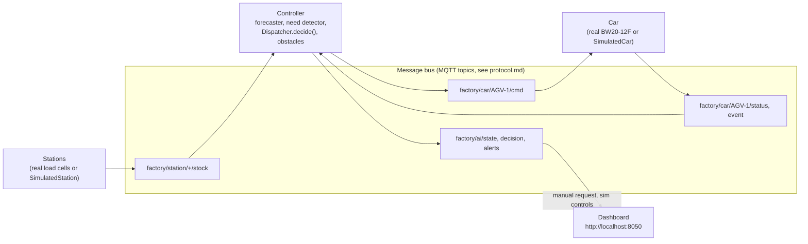

# Architecture

## 1. Whole system

The AI runs **locally** on the laptop, so decisions take milliseconds and the factory keeps running without internet. The cloud mirrors all data for the dashboard and for logging.

## 2. One decision, step by step

## 3. How the ML ranker is trained

The model only sees times and numbers, never node or material names. Its training also includes 400 random factory layouts. So a new or changed track only needs an updated `config/factory_layout.yaml`, not retraining: it scores 91.2 % on factories it has never seen.

Why learn from an optimizer instead of using it directly?
- The optimizer has to try every order: 7 requests is 5,040 orders, and 10 requests is 3.6 million. The ranker compares pairs, so it stays fast however many requests are waiting.
- The optimizer still runs beside the ranker for small cases. It checks every decision ("the exact optimizer agrees") and gives the "what if" explanations.
- Later, the ranker can be retrained on **real logged runs**, where no exact model of the factory exists.

## 4. Running it: controller, devices, dashboard

- **`MemoryBus`** carries the topics inside one Python process (simulation and tests). **`MqttBus`** carries the same topics through Mosquitto, for real hardware and for the cloud bridge. Nothing else changes.
- The **controller** owns the AI's view of the factory. It re-decides every time the car becomes idle, and while the car is busy it publishes a preview of the next choice.
- The **simulated car** executes the junction commands on its own copy of the track and doesn't know the planned path, exactly like the real car. If a command were wrong, it would end up somewhere else and report an error. So every simulated delivery also tests the route commands.

## 5. Training on live operation (DAgger)

The first models learned from random situations. When the factory actually runs, the queues look different: the need detector creates many requests with moderate slack, and near-ties are common. Measured live, the model matched the optimizer in only 76 % of decisions, against 91 % offline. This is the classic *distribution shift* problem of imitation learning.

The fix (`scripts/train_live.py`, the DAgger method):
1. Run the factory quickly with the current model making the decisions (20 % random choices, to also see what happens after mistakes).
2. Label every situation it met with the exact optimizer.
3. Retrain on the random situations plus all live situations.
4. Repeat.

Two rounds raised live accuracy from 76 % to 84 %, and halved the extra cost of its mistakes, with no loss on the offline tests.

## 6. Factors the AI uses

| Factor | Where it comes from |
|---|---|
| Stock left at the station | load cell |
| Usage rate | forecaster (slope of the last 2 minutes of readings) |
| Time until empty, time until safety level | stock ÷ rate |
| Trip time (car → rack → station, with turns, lift and drop) | path planner + calibrated car speed |
| Slack = time until empty − trip time | derived |
| Station criticality (1–3) | config |
| How long the request has waited | request time |
| What happens to the other request if this one goes first | path planner, for every pair |
| Warehouse stock, room for a box, battery, blocked lines | hard safety rules, checked before the ML |

## 7. Code map

| File | Job |
|---|---|
| `agv_brain/models.py` | data types, loading `config/materials.yaml` |
| `agv_brain/factory_map.py` | track graph, Dijkstra with turn costs, junction commands, blocked lines, re-routing |
| `agv_brain/forecaster.py` | usage rate from load-cell readings |
| `agv_brain/need_detector.py` | automatic requests from sensor data |
| `agv_brain/safety.py` | hard rules before the ML |
| `agv_brain/simulator.py` | scoring a plan; random situations |
| `agv_brain/layouts.py` | random factory layouts for training and testing |
| `agv_brain/optimizer.py` | the exact teacher |
| `agv_brain/baselines.py` | simple rules to compare against; `rollout` |
| `agv_brain/features.py` | the numbers the ML sees |
| `agv_brain/ranker.py` | the ML model |
| `agv_brain/dataset.py` | training-data generation |
| `agv_brain/explain.py` | reasons and what-if |
| `agv_brain/dispatcher.py` | puts it all together: `Dispatcher.decide()` |
| `agv_brain/live_dataset.py` | fast factory loop for live-operation training data and live accuracy |
| `agv_brain/bus.py` | `MemoryBus`, `MqttBus`, simulation `Clock` |
| `agv_brain/protocol.py` | topic names and message builders |
| `agv_brain/controller.py` | runs the AI on live messages; tasks, position tracking, obstacles, charging |
| `agv_brain/sim_devices.py` | `SimulatedCar`, `SimulatedStation` |
| `agv_brain/factory_sim.py` | a whole simulated factory in one object |
| `agv_brain/eventlog.py` | CSV logs of readings, decisions and events |
| `agv_brain/dashboard/` | the live dashboard (server + page) |
