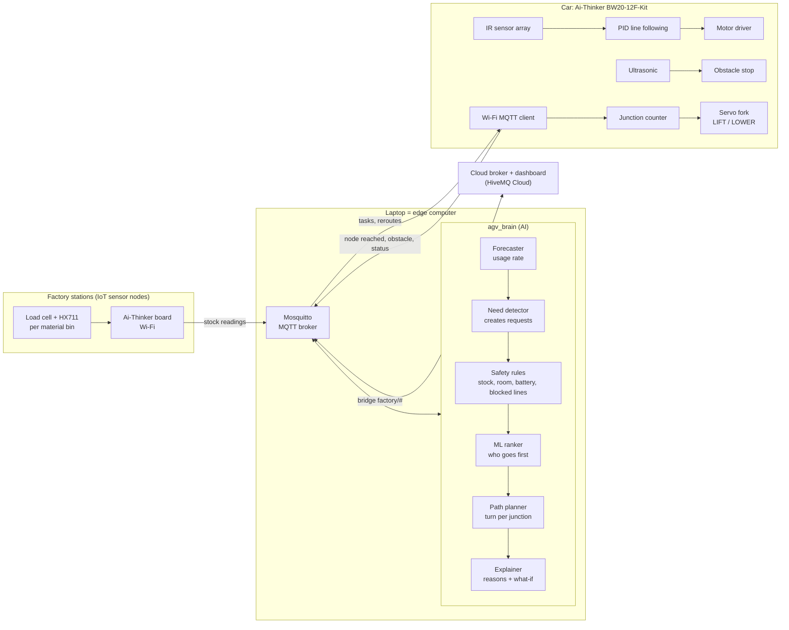
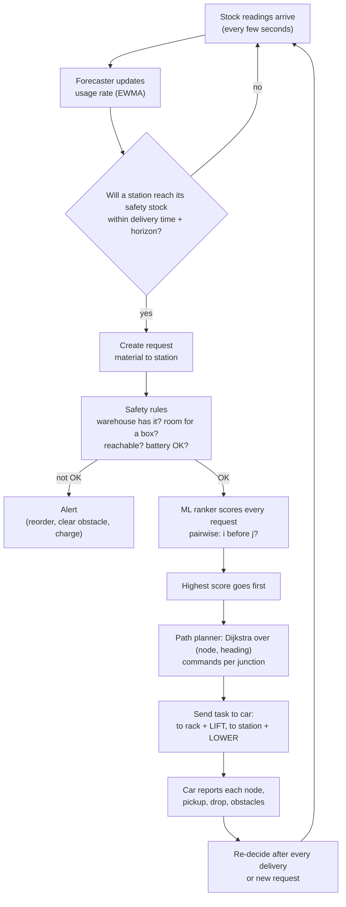
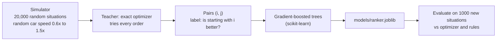

# Architecture

## 1. Whole system

The AI runs **locally** on the laptop, so decisions take milliseconds and the factory keeps running without internet. The cloud mirrors all data for the dashboard and for logging.

## 2. One decision, step by step

## 3. How the ML ranker is trained

Why learn from an optimizer instead of using it directly?
- The optimizer has to try every order: 7 requests is 5,040 orders, and 10 requests is 3.6 million. The ranker compares pairs, so it stays fast however many requests are waiting.
- The optimizer still runs beside the ranker for small cases. It checks every decision ("the exact optimizer agrees") and gives the "what if" explanations.
- Later, the ranker can be retrained on **real logged runs**, where no exact model of the factory exists.

## 4. Factors the AI uses

| Factor | Where it comes from |
|---|---|
| Stock left at the station | load cell |
| Usage rate | forecaster (EWMA over the readings) |
| Time until empty, time until safety level | stock ÷ rate |
| Trip time (car → rack → station, with turns, lift and drop) | path planner + calibrated car speed |
| Slack = time until empty − trip time | derived |
| Station criticality (1–3) | config |
| How long the request has waited | request time |
| What happens to the other request if this one goes first | path planner, for every pair |
| Warehouse stock, room for a box, battery, blocked lines | hard safety rules, checked before the ML |

## 5. Code map

| File | Job |
|---|---|
| `agv_brain/models.py` | data types, loading `config/materials.yaml` |
| `agv_brain/factory_map.py` | track graph, Dijkstra with turn costs, junction commands, blocked lines, re-routing |
| `agv_brain/forecaster.py` | usage rate from load-cell readings |
| `agv_brain/need_detector.py` | automatic requests from sensor data |
| `agv_brain/safety.py` | hard rules before the ML |
| `agv_brain/simulator.py` | scoring a plan; random situations |
| `agv_brain/optimizer.py` | the exact teacher |
| `agv_brain/baselines.py` | simple rules to compare against; `rollout` |
| `agv_brain/features.py` | the numbers the ML sees |
| `agv_brain/ranker.py` | the ML model |
| `agv_brain/dataset.py` | training-data generation |
| `agv_brain/explain.py` | reasons and what-if |
| `agv_brain/dispatcher.py` | puts it all together: `Dispatcher.decide()` |
