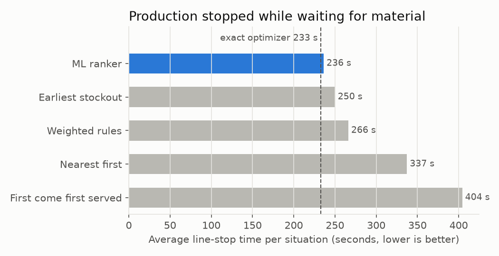
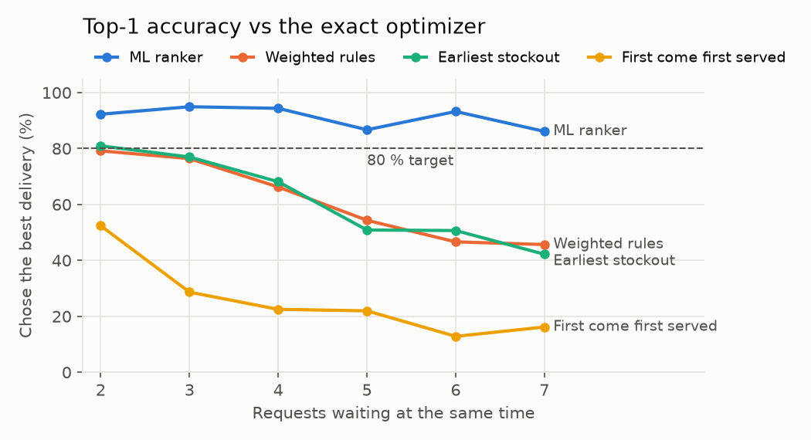
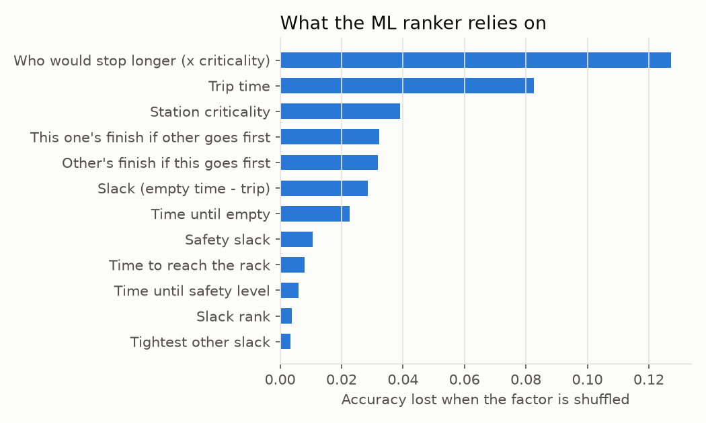

# Evaluation report

Generated by `python scripts/evaluate.py --scenarios 1000 --seed 20261103`. 1000 unseen situations with 2-7 requests each (training used 2-6), random car position and speed.

**AI accuracy (top-1 vs exact optimizer): 91.2% - target 80 %: PASS**

Pairwise accuracy ("should i go before j?") on the same unseen data: 94.0%

## All policies

| Policy | Top-1 accuracy | Avg line stop | Situations with a stop | Extra cost vs optimal | Decision time (mean / p95) |
|---|---|---|---|---|---|
| ML ranker | 91.2% | 236.3 s | 80.3% | 1.1 % | 5.04 / 6.45 ms |
| Weighted rules | 61.7% | 266.2 s | 80.8% | 16.8 % | 0.01 / 0.02 ms |
| Earliest stockout | 61.8% | 250.0 s | 80.0% | 19.1 % | 0.01 / 0.01 ms |
| Nearest first | 39.2% | 337.3 s | 88.2% | 100.9 % | 0.01 / 0.02 ms |
| First come first served | 26.0% | 404.3 s | 89.0% | 149.9 % | 0.01 / 0.01 ms |
| Exact optimizer | 100.0% | 232.6 s | 80.4% | 0.0 % | - |

The ML ranker cuts line-stop time by 42% compared with first come, first served.

The test situations are deliberately overloaded (many urgent requests at once, one car), so even the exact optimizer cannot avoid every stop. What matters is how close each policy gets to the optimizer.

## ML accuracy by number of requests

| Requests | Top-1 accuracy | Situations |
|---|---|---|
| 2 | 92.3% | 168 |
| 3 | 94.9% | 178 |
| 4 | 94.4% | 160 |
| 5 | 86.7% | 173 |
| 6 | 93.2% | 148 |
| 7 (more than in training) | 86.1% | 173 |

## Pairwise confusion matrix (ML)

| | predicted: j first | predicted: i first |
|---|---|---|
| **actual: j first** | 8679 | 566 |
| **actual: i first** | 543 | 8702 |

## Most important factors

| Factor | Importance |
|---|---|
| Who would stop longer (x criticality) (`late_diff_crit`) | 0.1273 |
| Trip time (`trip_s`) | 0.0825 |
| Station criticality (`criticality`) | 0.0391 |
| This one's finish if other goes first (`chain_ji_s`) | 0.0324 |
| Other's finish if this goes first (`chain_ij_s`) | 0.0319 |
| Slack (empty time - trip) (`slack_s`) | 0.0285 |
| Time until empty (`stockout_s`) | 0.0226 |
| Safety slack (`safety_slack_s`) | 0.0105 |
| Time to reach the rack (`to_rack_s`) | 0.0079 |
| Time until safety level (`below_safety_s`) | 0.0060 |

## Charts

