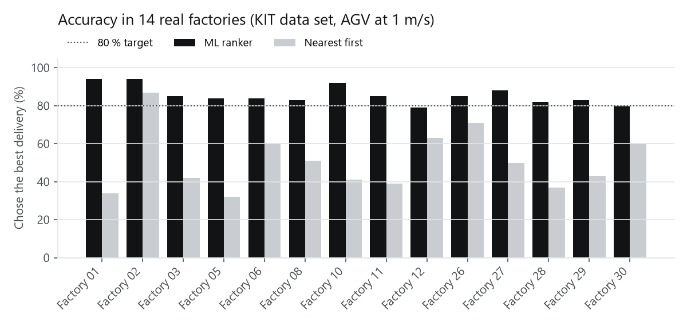

# Evaluation on real factory layouts

Generated by `python scripts/evaluate_real_layouts.py --per-layout 100`.

**AI accuracy in 14 real factories (top-1 vs exact optimizer): 85.6% - target 80 %: PASS**

## What was tested

The model was trained only on simulated factories. Here it works in real ones: the 14 industry layouts of the KIT AGV data set (Sperling et al., *IEEE Access* 11, 2023, CC BY 4.0) that have more than one transport route. The other 16 industry layouts are shuttles between two points, with nothing to choose.

- **Real:** the stations, the driving distance between them (2-340 m), which source supplies which station, and how many trips per hour each route has (busy routes get requests more often).
- **Still simulated, as in training:** stock left, usage rate, criticality and waiting time of each request, and where the car is. The data set is a plan, not a snapshot of one moment.
- **Assumed:** the AGV drives at 1 m/s, a typical industrial speed, and takes 4 s to load or unload, like our car. Trip time = distance / speed; the data has no track drawing, so no junction turns.

1400 situations (100 per factory), 2-7 requests each, every one labelled by the exact optimizer.

## Results (AGV at 1 m/s)

| Policy | Top-1 accuracy | Avg line stop | Situations with a stop | Extra cost vs optimal | Decision time (mean / p95) |
|---|---|---|---|---|---|
| ML ranker | 85.6% | 799.5 s | 87.0% | 3.0 % | 20.92 / 28.69 ms |
| Weighted rules | 41.7% | 1418.7 s | 87.7% | 64.1 % | 0.05 / 0.08 ms |
| Earliest stockout | 48.8% | 1171.6 s | 86.8% | 48.9 % | 0.01 / 0.02 ms |
| Nearest first | 50.7% | 860.4 s | 91.0% | 55.2 % | 0.05 / 0.08 ms |
| First come first served | 26.6% | 1279.0 s | 92.6% | 138.2 % | 0.02 / 0.03 ms |
| Exact optimizer | 100.0% | 779.4 s | 86.6% | 0.0 % | - |

The ML ranker cuts line-stop time by 37% compared with first come, first served. The distances are much longer than on our track, so stop times are longer for every policy, the optimizer included.

## Each factory

| Factory | Stations | Routes | ML ranker | Nearest first |
|---|---|---|---|---|
| Industry01 | 7 | 5 | 94% | 34% |
| Industry02 | 4 | 2 | 94% | 87% |
| Industry03 | 15 | 11 | 85% | 42% |
| Industry05 | 10 | 15 | 84% | 32% |
| Industry06 | 58 | 61 | 84% | 60% |
| Industry08 | 4 | 4 | 83% | 51% |
| Industry10 | 7 | 6 | 92% | 41% |
| Industry11 | 9 | 29 | 85% | 39% |
| Industry12 | 7 | 6 | 79% | 63% |
| Industry26 | 23 | 44 | 85% | 71% |
| Industry27 | 6 | 17 | 88% | 50% |
| Industry28 | 9 | 8 | 82% | 37% |
| Industry29 | 11 | 14 | 83% | 43% |
| Industry30 | 5 | 5 | 80% | 60% |

Each factory has 100 situations, so one factory's figure can be off by several points by chance. The total above is the reliable number.

## Speed check

Trip times depend on the AGV speed, which the data set does not give. The test is repeated at other speeds:

| AGV speed | Situations | ML ranker | Best simple rule |
|---|---|---|---|
| 0.5 m/s | 560 | 85.2% | 59.5% (Nearest first) |
| 1 m/s | 1400 | 85.6% | 50.7% (Nearest first) |
| 2 m/s | 560 | 87.7% | 60.2% (Earliest stockout) |

## Chart

