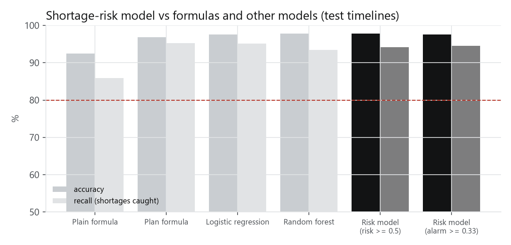
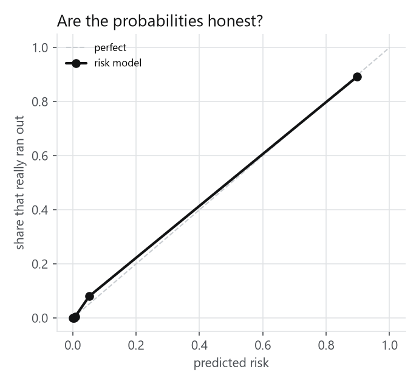
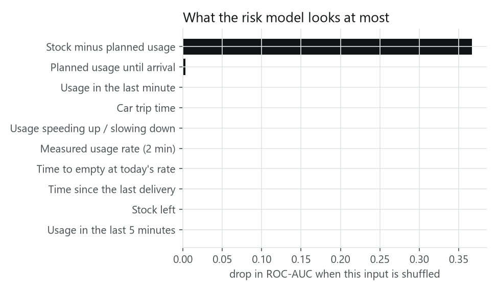

# Shortage-risk model: evaluation

Generated by `python scripts/evaluate_risk.py`. Data: `scripts/generate_risk_dataset.py` (43299 rows from 180 simulated factory timelines, plus 9603 rows on 40 timelines in factories never used for training).

**Accuracy on test timelines it never saw: 97.8% - target 80 %: PASS**

**Accuracy in factories it never saw: 97.7% - target 80 %: PASS**

## What it predicts

For one station and one material: the probability that the station runs out **before a box sent now could arrive** (`shortage_before_delivery`). The answer comes from the future of the simulated timeline: real usage changes with shifts, production orders, surges nobody announced, downtime and noise. The inputs only see the past readings and the production plan. All data is simulated.

Test set: 5871 rows from 28 timelines (15 %), never used for training or calibration. 27.0% of them are real shortages.

## Compared with formulas and other models (test timelines)

| Method | Accuracy | Precision | Recall | F1 | ROC-AUC | PR-AUC | Brier (lower = better) |
|---|---|---|---|---|---|---|---|
| Plain formula | 92.4% | 86.0% | 85.9% | 85.9% | 0.904 | 0.777 | 0.0760 |
| Plan formula | 96.9% | 93.3% | 95.2% | 94.3% | 0.963 | 0.902 | 0.0313 |
| Logistic regression | 97.6% | 95.9% | 95.1% | 95.5% | 0.996 | 0.991 | 0.0193 |
| Random forest | 97.8% | 98.3% | 93.4% | 95.8% | 0.996 | 0.992 | 0.0172 |
| Risk model (risk >= 0.5) | 97.8% | 97.5% | 94.1% | 95.8% | 0.996 | 0.988 | 0.0174 |
| Risk model (alarm >= 0.33) | 97.6% | 96.5% | 94.6% | 95.5% | 0.996 | 0.988 | 0.0174 |

- **Accuracy** = share of all moments judged right. **Recall** = share of real shortages caught. **Precision** = share of alarms that were real. Accuracy alone can hide missed shortages, because most moments are safe: a model that always said "safe" would score 73.0% accuracy and catch nothing.
- **ROC-AUC / Brier** judge the probability itself. The formulas only answer yes or no, so their scores here are much weaker: they cannot say *how* risky a station is.
- The alarm threshold (0.33) was chosen on the validation timelines to catch at least 95 % of the shortages there; on the test timelines it catches 94.6%. It raises more alarms than 0.5 but misses fewer shortages.
- Honest reading: the plan formula is already strong (96.9%), because most moments are clearly safe or clearly not. The model's gain is on the close calls (below) and in giving a calibrated probability.

## Confusion matrix (risk model, risk >= 0.5)

| | predicted: safe | predicted: shortage |
|---|---|---|
| **really safe** | 4245 | 39 |
| **really ran out** | 93 | 1494 |

## Where it helps (accuracy, test timelines)

| Situations | Rows | Shortage rate | Plain formula | Plan formula | Risk model |
|---|---|---|---|---|---|
| close calls (plain formula within 2 min of the line) | 1855 | 46.8% | 81.5% | 91.7% | **94.4%** |
| clear cases | 4016 | 17.9% | 97.4% | 99.3% | **99.3%** |
| day shift (busiest) | 1831 | 35.8% | 91.5% | 96.6% | **97.5%** |
| evening shift | 1726 | 30.4% | 93.9% | 96.9% | **97.7%** |
| night shift (quietest) | 2314 | 17.6% | 92.0% | 97.1% | **98.0%** |
| production orders running | 1568 | 33.7% | 91.1% | 96.9% | **97.5%** |
| no production orders | 4303 | 24.6% | 92.9% | 96.8% | **97.8%** |

## Factories it never saw

9603 rows on 40 timelines in random factories built from another seed.

| Method | Accuracy |
|---|---|
| Plain formula | 92.2% |
| Plan formula | 97.1% |
| Risk model | 97.7% |

Risk model ROC-AUC on these factories: 0.996.

## Which inputs matter (feature sets)

The same tree model, trained with fewer inputs (risk >= 0.5, test timelines). `planned_use_eta` and `planned_margin` are calculated before the model (nominal rate x the plan until the box arrives); the second row shows how well the trees do when they must work that out from the raw inputs themselves.

| Inputs | Accuracy | ROC-AUC |
|---|---|---|
| all inputs | 97.7% | 0.997 |
| raw inputs only (no planned_use_eta / planned_margin) | 96.0% | 0.994 |
| without the production plan | 93.5% | 0.982 |
| only stock, rate and arrival time | 92.3% | 0.974 |

## Most important inputs

Permutation importance: how much the ROC-AUC drops when one input is shuffled. Inputs that carry the same information share the credit, so when `planned_margin` is there, the raw inputs it is made from look unimportant; the feature-set table above is the fairer view.

| Input | Importance |
|---|---|
| Stock minus planned usage (`planned_margin`) | 0.3671 |
| Planned usage until arrival (`planned_use_eta`) | 0.0033 |
| Usage in the last minute (`rate_1m`) | 0.0001 |
| Car trip time (`trip_s`) | 0.0001 |
| Usage speeding up / slowing down (`rate_trend`) | 0.0001 |
| Measured usage rate (2 min) (`rate_est_per_min`) | 0.0000 |
| Time to empty at today's rate (`tte_naive_s`) | 0.0000 |
| Time since the last delivery (`since_delivery_s`) | 0.0000 |
| Stock left (`stock`) | 0.0000 |
| Usage in the last 5 minutes (`rate_5m`) | 0.0000 |

## Calibration

Rows grouped by predicted risk, against the share that really ran out:

| Predicted risk (mean) | Really ran out |
|---|---|
| 0.00 | 0.00 |
| 0.01 | 0.00 |
| 0.01 | 0.01 |
| 0.05 | 0.08 |
| 0.90 | 0.89 |

## Speed

Risk for 6 stations at once: 10.48 ms mean, 16.71 ms p95 on this laptop.

## Charts

